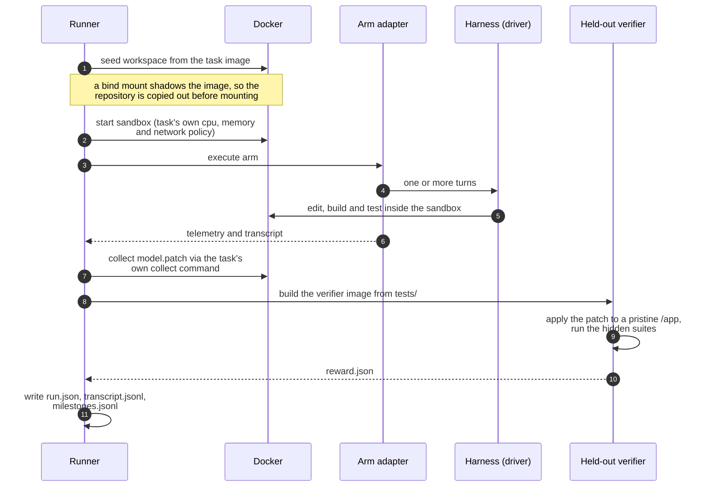

# superstate-eval

An independent lab for measuring what a control plane adds to a coding agent.

[Superstate](https://github.com/climate-x-org/superstate) is a control plane: it
sits above the harness, decides which task the agent is given next, and gates
whether the work may advance. This repository exists to answer whether that
layer actually helps, and at what cost.

## What is measured

The comparison is paired. The same harness, the same model and the same task are
run with and without a layer on top, and the headline figure is the difference
between them rather than an absolute pass rate.

| Arm | What runs |
|---|---|
| `vanilla` | The harness on its own |
| `superpowers` | The harness plus a skills library |
| `superstate` | The harness plus the control plane |

Two axes vary independently: the **driver** (which harness executes the work,
currently Claude Code or agy) and the **arm** (which layer sits on top). Both are
recorded on every run, because a result is not interpretable without knowing
which harness produced it.

Because the design is paired, anything present in all three arms cancels out of
the difference. That includes the harness's own system prompt and tooling, which
would otherwise be a confound. What the design does require is symmetry: every
arm starts from an identical workspace, and anything differing between arms other
than the treatment is a defect in the harness rather than a finding.

## What is reported

Pass rate alone is a poor signal at small sample sizes, so runs report:

- **Control-plane lift**, paired by harness and task, with the tasks gained and
  lost listed individually. At nine tasks a single task is worth eleven
  percentage points, so the gained and lost lists carry more information than the
  percentage.
- **Test pass fractions** from the task's own verifier, split into fail-to-pass
  and pass-to-pass, so a run that implements most of a feature is distinguishable
  from one that implements none of it.
- **Tokens and wall clock per solve.** A layer that matches the baseline on pass
  rate while halving token use is a result worth having.
- **Provenance**: which engine ran, whether the plan was actually decomposed,
  whether execution was isolated, and which sandbox contract applied.

## How a run works



Grading is held out. The verifier is built from the task's own `tests/`
directory and runs in a separate container against the patch applied to an
untouched checkout, so an agent cannot influence its own score by editing tests
or leaving artefacts in the workspace. The verifier image is deleted after
grading, because a cached one is the answer key sitting on the host.

## Autonomous TDD & The Anti-Cheating Invariant

See [docs/EVALUATION-PHILOSOPHY.md](docs/EVALUATION-PHILOSOPHY.md) for the complete manifesto.

* **No Leaked Answer Keys:** Pre-seeding maintainer reproduction tests into the workspace is cheating in SWE benchmarking. The maintainer's test suite remains sealed at `/tests/` until post-run grading.
* **No Synthetic Fixtures:** Hand-authored string fixtures (`GATE_FIXTURES`) are banned. They caused a 17% gate precision collapse by certifying partial work.
* **Autonomous TDD State DAG:** When a repo is clean on Turn 0, the daemon executes a deterministic 2-node graph:
  1. **Milestone 1 (`tdd-reproduction-test`):** Worker authors reproduction test in `tests/test_reproduce_issue.py` (gate: test fails cleanly RED). Git checkpoint recorded.
  2. **Milestone 2 (`fix-implementation`):** Worker implements fix (gate: reproduction test + suite pass GREEN). Accelerated by Tree-sitter Test Impact Slicing, bounded by Tool Output Shunting, and protected by Scoped Rollback.
* **Post-Run Grader:** Held-out maintainer tests score the final git patch.

## Quick start

```bash
uv sync

# Zero-cost differential parity between the Rust and Python engines
make parity

# Full suite
make test

# Only the tests that drive a real engine and a real Docker daemon
make integration

# Lint and type check
make lint

# Reclaim Docker disk
make clean-docker
```

A live paired run, one task through every arm:

```bash
uv run python scripts/paired_run.py \
    --task ~/.cache/agent-rules/frontier-eval/tasks/anko-typed-variable-bindings \
    --model gemini-3.8-flash-low
```

Add `--only-with-verifier` to restrict a cohort to tasks that ship a held-out
verifier.

## Tasks & Repository-First Suites

Evaluation is conducted exclusively on **genuine software engineering repositories** (`SWE_CORE_TASKS`). All toy command-line puzzles and single-file scripts (such as visual chess puzzles or regex filters) are permanently excluded because they fail to test multi-file software engineering control planes.

* **`SWE-Canary` (`scripts/run_canary.sh`):** A fast (~15–20 min) tri-language slice for continuous development and PR verification:
  1. `build-cython-ext` (Python/C: `SPOCKnots/pyknotid` — C extension upgrades, build, pytest)
  2. `scc-bounded-memory-spilling` (Go: `boyter/scc` — systems architecture, disk spilling)
  3. `katex-multicolumn-array-spans` (TypeScript: `KaTeX/KaTeX` — AST parsing, math array layout)
* **`SWE-Core` (`--core`):** The 9 canonical open-source repositories (8 DataCurve repositories + `build-cython-ext`) used for full releases and publishing benchmark lifts. All ship held-out maintainer test suites sealed at `/tests/`.

## Differential parity

`make parity` runs both state engine implementations over identical plan fixtures
and compares the result. It costs nothing and needs no model.

The comparison is semantic rather than byte-level. The two engines represent
state differently: the Rust engine stores a structured task specification and
timestamped ledger entries, the Python engine stores flat strings. That is a
difference in capability rather than a defect, since the structured form carries
dependency data in the state itself and can therefore answer `state ready`
without re-reading the plan. Comparing raw documents would only ever report that
difference and never test whether the engines behave alike, so both are
normalised to what they are meant to agree on: which tasks, in what order, with
which findings.

Engine selection is explicit. `superstate` on `PATH` is a shim into the
agent-rules Python package, so resolving by name silently selects the Python
implementation; use `SUPERSTATE_BIN` or the `engine` argument, and note that
resolution prefers the most recently built artefact so a stale release build
cannot shadow a fresh one.

## Layout

```
lab/
├── benchmarks/task_loader.py   # task.toml and instruction.md, including the sandbox contract
├── engine/
│   ├── adapters/               # the three arms
│   ├── drivers/                # harnesses: Claude Code, agy, in-container
│   ├── runner.py               # cohort execution, budgets, concurrency
│   ├── verifier.py             # held-out grading in a separate container
│   ├── extractor.py            # patch collection and scoring
│   ├── trace.py                # run.json, transcripts, milestone records
│   └── reporter.py             # paired lift and failure clustering
└── sandbox/                    # Docker lifecycle, workspace seeding, answer-key sealing
```

## A note on what this harness has taught us

Seven defects have been found in this harness by running real tasks, and none of
them was catchable by the unit suite: each lived in a seam between components
that were individually well tested. The worst produced no error at all. The
control-plane arm silently degraded to baseline behaviour while still being
labelled as the treatment. Across a cohort that reads as "the control plane
behaves exactly like the baseline", which is a conclusion rather than a crash.

Guards now exist for that specific failure (a run that parses no milestones fails
rather than impersonating the baseline, and provenance records whether
decomposition actually happened), and `tests/test_state_engine_loop.py` drives a
real engine end to end rather than a stub. The general lesson is recorded here
because it will apply to the next thing added: prefer a test that runs the real
binary, and when fixing a defect, check whether the same mistake exists
elsewhere. Two of the seven were the same error repeated in a second place.
