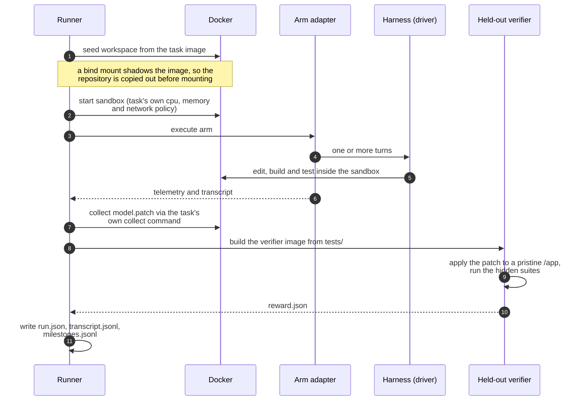

# superstate-eval

An independent lab for measuring coding-agent harnesses on real software tasks.

The question it answers: holding the model, the task and the grader fixed, what does the harness
change? Mostly it compares [blyte](https://github.com/climate-x-org/superstate) (the lean harness
developed next door) against agy, on real repositories, with grading the agent cannot see.

It began as a lab for a control plane that sat above the harness (superstate's daemon, MCP server
and state engine). Those layers were deleted from superstate on 2026-09-25, and their arms were
removed from this repository (#46, #47, #49); their results remain in `results/`, `FINDINGS.md` and
`EXPERIMENTS.md`.

## What is measured

Runs are paired: every harness runs the same task, with the same model and prompt, graded by the
same held-out verifier. Repeats are interleaved (A1 B1 A2 B2 …), so drift over a session is not
charged to whichever harness ran later.

**Harness mode** (the current work): `scripts/paired_run.py --harnesses agy "blyte[folded]"`. The
first harness is the baseline; each harness's settings are spelled out in its name
(`blyte[conversational]`, `blyte[folded,fold-budget-16k]`, …).

**Arm mode** (from the control-plane era): the same harness with or without a layer on top.
`vanilla` (the harness alone) and `superpowers` (plus a skills library) remain.

A result is not interpretable without knowing which harness produced it, so the harness and its
build are recorded on every run.

## What is reported

Pass rate alone is a poor signal at small sample sizes, so runs report:

- **Paired results per task**, harness against baseline: passes, cost and wall time, with the
  tasks gained and lost listed individually. At a handful of tasks one task swings the rate by
  double digits, so the per-task rows carry more information than a headline percentage.
- **Test pass fractions** from the task's own verifier, split into fail-to-pass
  and pass-to-pass, so a run that implements most of a feature is distinguishable
  from one that implements none of it.
- **Tokens, cost and wall clock per run**, and for blyte its own split of the time into model,
  tools and gate. A harness that matches the baseline on passes while halving time or cost is a
  result worth having.
- **Provenance**: which engine ran, whether the plan was actually decomposed,
  whether execution was isolated, and which sandbox contract applied.

## How a run works



Grading is held out. The verifier is built from the task's own `tests/`
directory and runs in a separate container against the patch applied to an
untouched checkout, so an agent cannot influence its own score by editing tests
or leaving artefacts in the workspace. The verifier image is deleted after
grading, because a cached one is the answer key sitting on the host.

## The anti-cheating invariants

See [docs/EVALUATION-PHILOSOPHY.md](docs/EVALUATION-PHILOSOPHY.md). In short: no leaked answer keys
(the maintainers' tests never enter the workspace), no hand-authored gate fixtures, and grading by
held-out tests against the final patch only.

## Quick start

```bash
uv sync

# Full suite
make test

# Only the tests that drive a real Docker daemon
make integration

# Lint and type check
make lint

# Reclaim Docker disk
make clean-docker
```

A live harness comparison (paid: it calls the model), one task, agy against blyte:

```bash
uv run python scripts/paired_run.py \
    --task ~/.cache/agent-rules/frontier-eval/tasks/anko-typed-variable-bindings \
    --harnesses agy "blyte[folded]" --repeats 3
```

`scripts/run_canary.sh` runs the three canary tasks the same way.

Add `--only-with-verifier` to restrict a cohort to tasks that ship a held-out
verifier.

## Tasks & Repository-First Suites

Evaluation is conducted exclusively on **genuine software engineering repositories** (`SWE_CORE_TASKS`). All toy command-line puzzles and single-file scripts (such as visual chess puzzles or regex filters) are permanently excluded because they fail to test multi-file software engineering control planes.

* **`SWE-Canary` (`scripts/run_canary.sh`):** A fast (~15–20 min) tri-language slice for continuous development and PR verification:
  1. `build-cython-ext` (Python/C: `SPOCKnots/pyknotid` — C extension upgrades, build, pytest)
  2. `scc-bounded-memory-spilling` (Go: `boyter/scc` — systems architecture, disk spilling)
  3. `katex-multicolumn-array-spans` (TypeScript: `KaTeX/KaTeX` — AST parsing, math array layout)
* **`SWE-Core` (`--core`):** The 9 canonical open-source repositories (8 DataCurve repositories + `build-cython-ext`) used for full releases and publishing benchmark lifts. All ship held-out maintainer test suites sealed at `/tests/`.

## Layout

```
lab/
├── benchmarks/task_loader.py   # task.toml and instruction.md, including the sandbox contract
├── engine/
│   ├── adapters/               # arms: vanilla (the pass-through) and superpowers
│   ├── drivers/                # harnesses: agy, blyte (native), Claude Code
│   ├── harnesses.py            # harness specs and the harness-vs-harness comparison
│   ├── runner.py               # cohort execution, budgets, concurrency
│   ├── verifier.py             # held-out grading in a separate container
│   ├── extractor.py            # patch collection and scoring
│   ├── trace.py                # run.json, transcripts, milestone records
│   └── reporter.py             # paired lift and failure clustering
└── sandbox/                    # Docker lifecycle, workspace seeding, answer-key sealing
```

## A note on what this harness has taught us

Seven defects have been found in this harness by running real tasks, and none of
them was catchable by the unit suite: each lived in a seam between components
that were individually well tested. The worst produced no error at all. The
control-plane arm silently degraded to baseline behaviour while still being
labelled as the treatment. Across a cohort that reads as "the control plane
behaves exactly like the baseline", which is a conclusion rather than a crash.

Guards were added for that specific failure (a run that parsed no milestones failed rather than
impersonating the baseline, and provenance recorded whether decomposition actually happened), along
with tests that drove the real engine end to end rather than a stub. The general lesson is recorded here
because it will apply to the next thing added: prefer a test that runs the real
binary, and when fixing a defect, check whether the same mistake exists
elsewhere. Two of the seven were the same error repeated in a second place.
