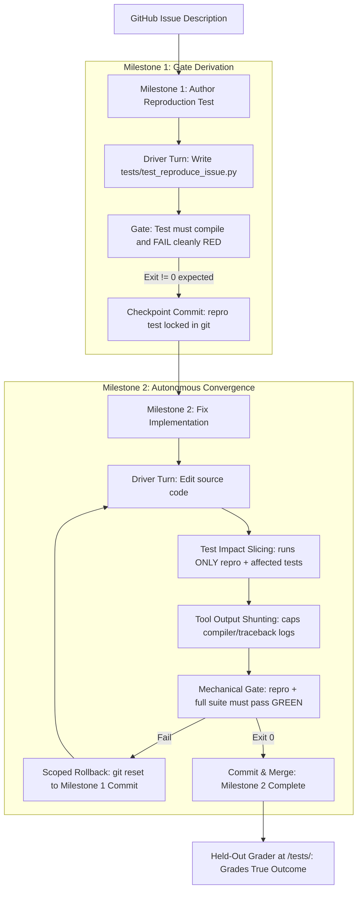

# Superstate Evaluation Philosophy & Benchmark Integrity Manifesto

This document defines the scientific principles, architectural standards, and integrity invariants governing the evaluation of [Superstate](https://github.com/climate-x-org/superstate) within `superstate-eval`.

---

## 1. Executive Summary & The Problem We Solved

Historically, coding agent benchmarks (such as SWE-bench and DataCurve) were designed to evaluate the **zero-shot inference capability of raw Large Language Models (LLMs)**. To prevent models from overfitting or gaming the benchmark, benchmark authors held out the test suite (`test_patch`) in a sealed directory (`/tests/`).

When applied to an autonomous, gate-driven execution engine like Superstate, this benchmark structure produced a catastrophic failure mode:

### 1.1 The Synthetic Gate Collapse
Because the repository's native test suite already passed on Turn 0 (`exit 0`), early harness iterations attempted to compensate by authoring **synthetic 10-line smoke tests** (`GATE_FIXTURES`).
* Across the DataCurve task family, empirical gate precision collapsed to **17%**.
* On `httpx-multipart-response-parsing`, a synthetic fixture checked basic multipart parsing and exited `0`. The gate-driven daemon faithfully stopped, having passed 1,393 of 1,394 tests. The sealed grader then executed and failed the run on a single RFC tab-folding assertion (`assert '1\tz' == '1 z'`).
* **The Root Defect:** Synthetic fixtures do not measure the agent or the control plane—they measure the human author's failure to foresee every edge case.

### 1.2 The Answer-Key Cheating Trap
The instinctive reaction to incomplete fixtures was to pre-seed the maintainer's official reproduction test directly into the workspace on Turn 0.
* However, in frontier SWE benchmarking, **pre-seeding the reproduction test is cheating**.
* The maintainer's test leaks the exact function names, argument signatures, and expected return types, converting an open-ended software engineering task into a trivial "make this specific test green" exercise.

---

## 2. The Core Evaluation Philosophy

To resolve this dissonance permanently, `superstate-eval` enforces four non-negotiable architectural invariants:

### Invariant 1: The Anti-Cheating Invariant (Sealed Grader Integrity)
The maintainer's official test suite (`test_patch`) remains **100% sealed** at container-root `/tests/`. It is never mounted into the workspace, never inspected during execution, and never used as a runtime verification command. The agent receives only the raw issue description and existing repository history.

### Invariant 2: Permanent Ban on Hand-Authored Synthetic Fixtures
The harness will **never maintain or execute synthetic string fixtures** (`GATE_FIXTURES`). Verification commands must either be:
1. Native repository test runners (`pytest`, `cargo test`, `make`, `npm test`) for broken-on-Turn-0 builds.
2. Reproduction tests authored autonomously by the agent itself.

### Invariant 3: The Non-Vacuous Gate Requirement
A gate command that returns exit code `0` on Turn 0 certifies nothing. Because Superstate's daemon is **gate-driven** (`$? == 0`), vacuous gates cause immediate false completion. Every valid evaluation task must prove RED on Turn 0 before code implementation begins.

### Invariant 4: Pure Mechanical Control vs. Conversational Vibes
Agent lifecycle must never be managed through prompt persuasion, cajoling instructions, or behavioral prompt contracts. The control plane operates strictly through:
* Directed Acyclic Graphs (`depends_on`).
* Unix process exit codes (`$? == 0` vs `!= 0`).
* Automated git checkpoints and hard resets (`git reset --hard milestone_start_commit`).

---

## 3. The Autonomous TDD State DAG

For tasks where the repository is clean on Turn 0, Superstate resolves issues through a deterministic 2-node dependency graph:

### Milestone 1: `tdd-reproduction-test`
* **Purpose:** The worker reads the issue and translates the requirements into an objective, executable acceptance test at `tests/test_reproduce_issue.py`.
* **Gate:** The test file must exist, compile cleanly, and fail (RED) when executed against the unfixed codebase.
* **Checkpoint:** Upon passing, Superstate creates a git checkpoint commit (`checkpoint: completed tdd-reproduction-test`).

### Milestone 2: `fix-implementation`
* **Purpose:** The worker edits source files until both the reproduction test and the repository's regression suite pass.
* **Gate:** `pytest tests/test_reproduce_issue.py && pytest tests/` exits `0`.
* **Test Impact Slicing:** Intermediate turns execute only tests impacted by AST changes (via Tree-sitter), slashing turn latency by 20–40%.
* **Tool Output Shunting:** Massive test tracebacks are saved to disk, providing only compact summaries to prevent LLM context degradation.
* **Scoped Rollback:** If an implementation attempt breaks compilation or existing tests, Superstate executes `git reset --hard <milestone_1_commit>`. The newly written reproduction test is **100% preserved**, while broken code edits are completely discarded.

### Post-Run Sealed Grading
Once the agent declares completion and commits Milestone 2, the harness applies the secret maintainer patch and runs the sealed grader. This objectively scores whether the agent's autonomous TDD loop achieved true generalization.

---

## 4. The Five Evaluation Metrics

Benchmark results in `superstate-eval` are measured across five primary dimensions:

1. **Feedback Velocity (Wall-Clock Reduction):** Does Test Impact Slicing provide faster feedback cycles compared to monolithic test execution (-20% to -40% latency)?
2. **Token Efficiency (Cost Reduction):** Do stateless turns and Tool Output Shunting reduce input/output token usage (-25% to -50% cost)?
3. **Autonomous Convergence:** Does the agent converge to a passing state without human intervention or conversational prompting?
4. **Fault Recovery (Scoped Rollback):** Does the state machine successfully recover from dead-end edits by reverting to milestone checkpoints?
5. **Held-Out Solve Rate:** Does the resulting codebase satisfy the sealed maintainer test suite?

---

## 5. Summary: Why This Tests the Superstate Ethos

Superstate is an autonomous control plane. It does not replace the LLM; it governs how the LLM interacts with code, files, compilers, and test suites.

By eliminating synthetic fixtures, preserving sealed grader integrity, and enforcing an Autonomous TDD dependency graph, `superstate-eval` provides a rigorous, cheat-free environment that definitively measures the mechanical power of state machines, AST slicing, tool shunting, and scoped rollback.
