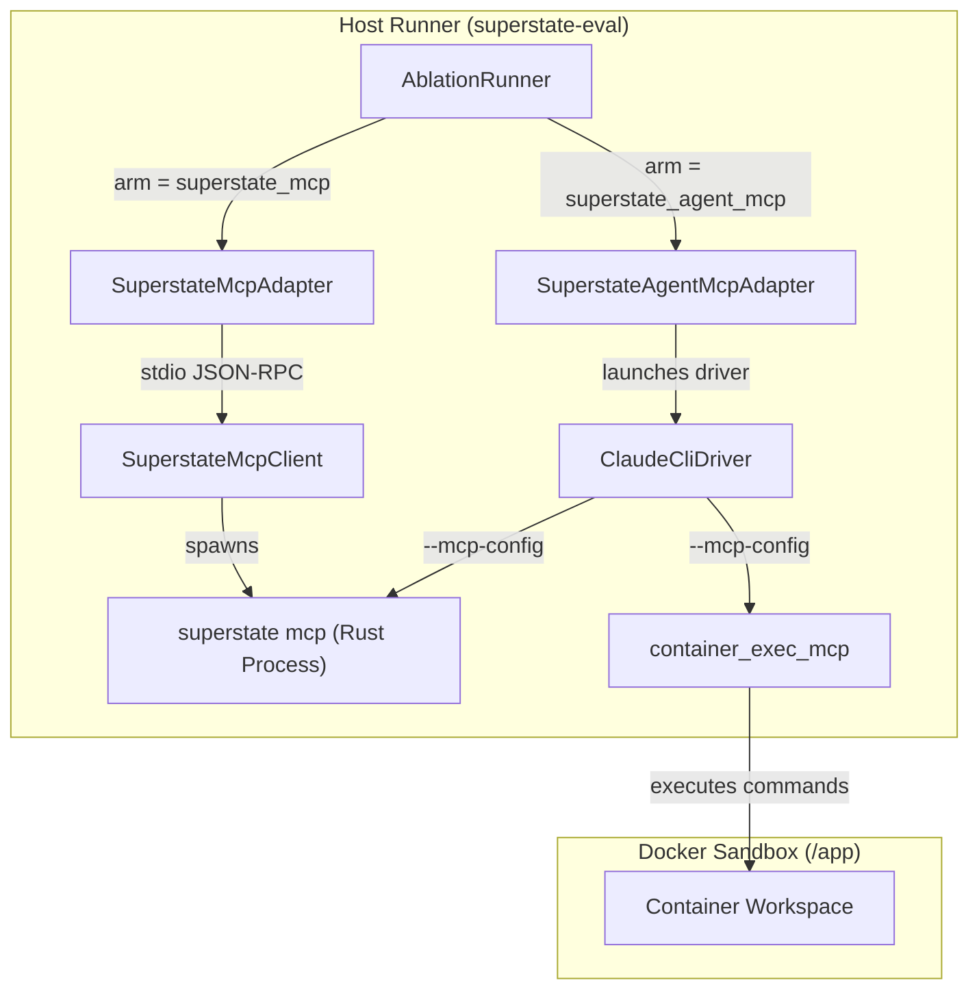

# Design Specification: MCP Evaluation Dual Architecture (`superstate-eval`)

- **Date:** 2026-09-12
- **Author:** Antigravity & Dan Fisher
- **Status:** Approved
- **Target Repository:** `superstate-eval` (`lab/engine/mcp/`, `lab/engine/adapters/`, `lab/engine/drivers/`, `lab/engine/runner.py`)

---

## 1. Executive Summary & Objective

With the completion of 100% feature and parameter parity between the Superstate CLI and the Model Context Protocol (MCP) server, `superstate mcp` exposes all 25 state management, inspection, verification, and worktree tools over standard JSON-RPC.

This specification details the **Dual MCP Architecture** for `superstate-eval`:
1. **Harness-Level MCP Orchestration (`superstate_mcp` / `superstate_rust_mcp` arm):** The evaluation adapter uses a persistent, high-performance stdio MCP client (`SuperstateMcpClient`) to drive state initialization, turnkey prompt generation, DAG resolution, and verification gate advancement over JSON-RPC rather than invoking CLI subprocesses.
2. **Agent-Level Autonomous Tooling (`superstate_agent_mcp` arm):** The agent driver exposes the 25 Superstate MCP tools directly to the agent runtime (e.g. Claude Code via `--mcp-config`). The agent is prompted with an autonomous contract to drive its own state transitions directly.

---

## 2. Architecture & Components



---

## 3. Detailed Component Design

### 3.1 `SuperstateMcpClient` (`lab/engine/mcp/client.py`)

A resilient Python client managing a child `superstate mcp` process communicating via stdio JSON-RPC 2.0.

#### Responsibilities:
- **Process Lifecycle:** Starts `superstate mcp` using the resolved binary path (`/Users/danielfisher/.cargo/bin/superstate` or `find_superstate_binary()`). Supports context management (`with SuperstateMcpClient(...) as client:`), automatically closing pipes and terminating child processes on cleanup.
- **Protocol Handshake:**
  - Sends `initialize` with `protocolVersion: "2024-11-05"`.
  - Emits `notifications/initialized` without expecting a reply.
  - Queries `tools/list` and caches tool metadata.
- **Tool Invocations (`call_tool`):**
  - Sends `tools/call` with `id`, `name`, and `arguments`.
  - Validates JSON-RPC responses and extracts text/JSON content from `result.content`.
  - Handles errors with clear exceptions (`McpRpcError`, `McpTimeoutError`).
- **Domain Helper Methods:**
  - `state_init(plan: Path | str, repo: Path | str, no_worktree: bool = False, worktree: bool = False, goal: Optional[str] = None)`
  - `state_prompt(repo: Path | str, with_graph: bool = False, task: Optional[str] = None, no_worktree: bool = False) -> str`
  - `state_next(repo: Path | str, verify_cmd: Optional[str] = None, verify_git_clean: bool = False, ignore_untracked_glob: Optional[str] = None) -> bool`
  - `state_status(repo: Path | str, json: bool = True) -> dict`
  - `state_ready(repo: Path | str) -> list[str]`
  - `state_doctor(repo: Path | str, repair: bool = False) -> dict`
  - `state_exec(repo: Path | str, cmd: str, verify_cmd: Optional[str] = None, rollback_on_fail: bool = False, advance: bool = False) -> dict`
  - `state_note(repo: Path | str, message: str) -> bool`
  - `worktree_clean(repo: Path | str, force: bool = False) -> dict`

### 3.2 Harness-Level Adapter: `SuperstateMcpAdapter` (`lab/engine/adapters/superstate_mcp.py`)

Subclasses `AgentAdapter`. Replaces CLI `subprocess.run` invocations with `SuperstateMcpClient` calls.

#### Execution Flow:
1. **Sanitize & Prepare:** Strip pre-existing guidance files, exclude harness artifacts in `.git/info/exclude`.
2. **Initialize:** Start `SuperstateMcpClient` in the workspace directory and call `client.state_init(plan=plan_file, repo=workspace_path)`.
3. **Milestone Loop:**
   - Query unblocked tasks via `client.state_ready(repo=workspace_path)`.
   - Obtain turnkey prompt via `client.state_prompt(repo=workspace_path, with_graph=True, no_worktree=self.no_worktree)`.
   - Dispatch turn to driver with the turnkey prompt.
   - Run verification gate command (inside Docker container if sandbox is active, or via `client.state_exec`).
   - If gate passes, commit changes and advance state via `client.state_next(repo=workspace_path, verify_git_clean=True)`.
   - Distill turn findings and record note via `client.state_note(repo=workspace_path, message=note)`.
4. **Teardown & Cleanup:** Prune any temporary worktrees via `client.worktree_clean(repo=workspace_path, force=True)` and terminate client process.

### 3.3 Agent-Level Autonomous Adapter: `SuperstateAgentMcpAdapter` (`lab/engine/adapters/superstate_agent_mcp.py`)

Evaluates autonomous agent behavior when the agent has direct tool access to `superstate` tools.

#### Execution Flow:
1. **Initialize State:** Initialize state via `SuperstateMcpClient`.
2. **Driver Configuration:** Pass the `superstate` MCP server config to the driver (`claude_cli` or `agy_cli`).
3. **Autonomous Prompt Contract:** Prompt the agent with the overall goal and explicit instructions on using the `state_*` tools:
   - "Use `state_status` or `state_show` to inspect pending tasks."
   - "Use `state_prompt` to view instructions and constraints for the active milestone."
   - "Write code and test your changes."
   - "Use `state_next` or `state_exec` to verify and advance your milestones."
   - "Record significant findings with `state_note`."
4. **Execution:** Driver runs in a multi-turn session until the agent declares completion or budget expires.
5. **Verification Check:** Adapter checks `state.status == "completed"` and verifies final state.

### 3.4 Driver Integration (`lab/engine/drivers/claude_cli.py`)

Update `ClaudeCliDriver`:
- Add `superstate_mcp: bool = False` configuration parameter.
- When enabled, include `superstate` in `_mcp_config(container_id)`:
  ```python
  mcp_servers = {
      MCP_SERVER_NAME: {
          "command": self.mcp_python,
          "args": ["-m", "lab.engine.drivers.container_exec_mcp"],
          ...
      }
  }
  if self.superstate_mcp:
      mcp_servers["superstate"] = {
          "command": str(superstate_bin),
          "args": ["mcp"],
      }
  ```
- Retain `--strict-mcp-config` to ensure zero leakage from host operator configuration.

### 3.5 Runner Arms Configuration (`lab/engine/runner.py`)

Register the new arms in `AblationRunner._get_adapter(arm: str)`:
- `superstate_mcp`, `superstate_rust_mcp`: Instantiates `SuperstateMcpAdapter(no_worktree=True, zero_turn_planning=True)`.
- `superstate_mcp_worktree`: Instantiates `SuperstateMcpAdapter(worktree=True, zero_turn_planning=True)`.
- `superstate_agent_mcp`: Instantiates `SuperstateAgentMcpAdapter()`.

---

## 4. Verification & Testing Strategy

1. **Unit Tests (`tests/test_superstate_mcp_client.py`):**
   - Test client lifecycle, handshake (`initialize` + `notifications/initialized`), and tool discovery.
   - Test error handling on bad requests and unknown tools.
   - Test typed wrapper methods against temporary Git repos.
2. **Adapter Tests (`tests/test_superstate_mcp_adapter.py`):**
   - Test `SuperstateMcpAdapter` state progression with `MockDriver`.
   - Verify provenance records `"transport": "mcp_stdio"` and tool metrics.
3. **Driver Tests (`tests/test_claude_cli_driver.py`):**
   - Verify `ClaudeCliDriver` generates valid MCP configs containing both `task` and `superstate`.
4. **End-to-End Runner Tests (`tests/test_runner.py`):**
   - Run task execution under `arm = "superstate_mcp"` with mock task spec.
