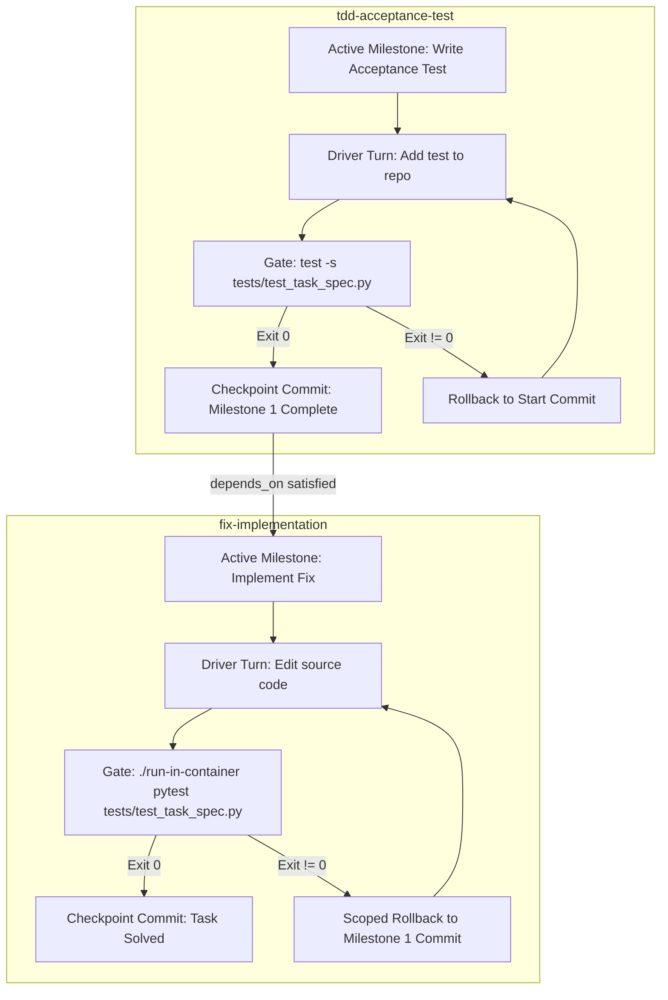

# Design Specification: Autonomous TDD DAG Execution & Hand-Authored Fixture Elimination

## 1. Executive Summary & Context

Recent benchmark findings in `superstate-eval` established that the newly merged autonomous daemon DAG transmission (`superstate daemon`) operates cleanly with scoped rollback and checkpoint commits (PR #36). However, evaluation telemetry revealed two critical architectural insights:
1. **Under-Exercised Graph Topology:** Existing benchmark runs passed tasks as a single monolithic goal (`"milestones_planned": 1`), leaving topological dependency resolution and multi-milestone scoped rollback unexercised in production.
2. **Hand-Authored Fixture Brittleness:** Synthetic, hand-authored string fixtures (`GATE_FIXTURES`) suffer from severe precision defects (17% precision on DataCurve). On `httpx`, a hand-authored fixture exited 0 prematurely on basic multipart strings, stopping the worker before full RFC tab-folding compliance was reached.

### Core User Directive
- **Eliminate Hand-Authored Fixtures:** Do not rely on synthetic harness snippets (`assert part.content == b"hello"`, etc.) as proxies for verification commands.
- **Zero Prompt Engineering to Manage Agents:** Do not use rhetorical persuasion, prompt contracts, or cajoling instructions to control agent lifecycle. The control plane must be 100% mechanical:
  - Directed Acyclic Graphs (`depends_on`).
  - Unix process exit codes (`$? == 0`) from native project test runners (`pytest`, `cargo test`).
  - Mechanical git resets (`git reset --hard milestone_start_commit`) on failure.

---

## 2. Architecture: Deterministic 2-Node TDD State Graph

Instead of relying on prompt instructions to tell the agent how to iterate, the state machine structure enforces Test-Driven Development (TDD) as a 2-node dependency graph:



### 2.1 Milestone Specifications

#### Node 1: `tdd-acceptance-test`
- **ID:** `tdd-acceptance-test`
- **Title:** `Author reproduction/acceptance test verifying task requirements`
- **Files:** `["tests/test_task_spec.py"]`
- **Depends on:** `[]`
- **Verification Command:**
  ```bash
  test -s tests/test_task_spec.py && ./run-in-container python3 -m py_compile tests/test_task_spec.py
  ```
- **Invariant:** Ensures the worker has created a non-empty, syntactically valid test file targeting the specification.
- **State Transition:** Upon exit code 0, the daemon commits the test file:
  `git commit -m "checkpoint: completed tdd-acceptance-test"`
  and updates `completed_tasks: ["tdd-acceptance-test"]`.

#### Node 2: `fix-implementation`
- **ID:** `fix-implementation`
- **Title:** `Implement codebase changes until acceptance test passes`
- **Files:** Source files relevant to the task (or repository root)
- **Depends on:** `["tdd-acceptance-test"]`
- **Verification Command:**
  ```bash
  ./run-in-container pytest tests/test_task_spec.py
  ```
- **Invariant:** The solution must satisfy the acceptance test written in Milestone 1.
- **Scoped Rollback Guarantee:** If Milestone 2 fails its gate, `DaemonRunner::perform_rollback` resets HEAD to `milestone_start_commit` (the commit created at the end of Milestone 1). The newly authored test in `tests/test_task_spec.py` is **100% preserved**, while any broken implementation edits are cleanly discarded.

---

## 3. Harness Integration in `superstate-eval`

### 3.1 Arm Definition
A new arm is registered in `lab/engine/runner.py`:
- **Arm Name:** `superstate_daemon_dag`
- **Adapter:** `SuperstateDaemonAdapter(tdd_dag=True, auto_rollback=True, advisory_review=True, name="superstate_daemon_dag")`

### 3.2 State Initialization (`_init_daemon_state`)
When `tdd_dag=True` is enabled:
1. `_init_daemon_state` inspects the task.
2. If `test_task_spec.py` or repository test suite is appropriate, it constructs the 2-milestone array:
   ```json
   [
     {
       "id": "tdd-acceptance-test",
       "title": "Author acceptance test in tests/test_task_spec.py",
       "verify_cmd": "test -s tests/test_task_spec.py && ./run-in-container python3 -m py_compile tests/test_task_spec.py",
       "files": ["tests/test_task_spec.py"]
     },
     {
       "id": "fix-implementation",
       "title": "Implement codebase fix to pass acceptance test",
       "verify_cmd": "./run-in-container pytest tests/test_task_spec.py",
       "depends_on": ["tdd-acceptance-test"],
       "files": []
     }
   ]
   ```
3. Passes `milestones=milestones` directly into `client.superstate_handoff(...)`.
4. Spawns `superstate state daemon --state .agent-state/state.json --auto-rollback --detach`.

### 3.3 Zero Prompt Engineering Compliance
- The worker driver receives **zero** behavioral prompt instructions.
- The prompt received by the worker is the standard Superstate turnkey prompt:
  ```text
  Active Milestone: {title}
  Target Files: {files}
  Verification: {verify_cmd}
  ```
- Execution is strictly guided by the presence of the milestone, its verification exit code, and automated git rollback.

---

## 4. Evaluation Strategy & Hypotheses

### 4.1 Experiment EXP-064
- **Question:** Does autonomous 2-node TDD DAG execution eliminate hand-authored fixture brittleness and improve solve rate on the 3-task Canary slice compared to single-shot `superstate_mcp`?
- **Arms:** `superstate_daemon_dag` vs `superstate_mcp`
- **Tasks:** `build-cython-ext`, `chess-best-move`, `httpx-multipart-response-parsing`
- **Metrics:**
  1. Solve rate (evaluated against the sealed held-out grader at container-root `/tests/`).
  2. Gate precision (calculated via `scripts/gate_precision.py`).
  3. Scoped rollback events and milestone transitions (`milestones_planned: 2`).

### 4.2 Success Criteria
1. `milestones_planned == 2` recorded in telemetry for all DAG tasks.
2. Scoped rollback preserves Milestone 1 tests upon Milestone 2 retries.
3. No reliance on `lab/benchmarks/gate_fixtures.py` synthetic assertions.
4. Pass rate >= baseline without prompt engineering.
