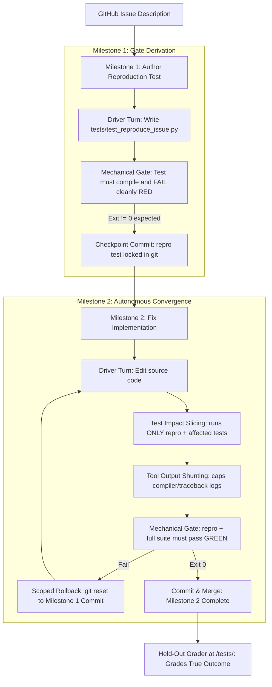

# Design Specification: Evaluation Philosophy & Autonomous TDD Benchmark Architecture

## 1. Executive Summary & Context

Evaluation findings in `superstate-eval` established that while the autonomous daemon (`superstate daemon`) operates cleanly with scoped rollback and test impact slicing (EXP-064), benchmark telemetry exposed a fundamental dissonance in how tasks were being evaluated:

1. **Synthetic Fixture Fragility:** For tasks where the official test suite was sealed at `/tests/`, the harness relied on hand-authored string fixtures (`GATE_FIXTURES`). On the DataCurve task family, gate precision collapsed to **17%**. On `httpx-multipart-response-parsing`, a hand-authored fixture exited 0 on basic multipart parsing, causing the gate-driven daemon to halt after passing 1,393 of 1,394 tests, only to be scored as a total failure by the sealed grader on a single tab-folding edge case.
2. **The "Gate Quality vs. Agent Quality" Dissonance:** When the verification command is a synthetic, incomplete script, the benchmark does not evaluate the agent or the control plane—it evaluates the blind spots of the human who wrote the fixture.
3. **The Answer-Key Dilemma:** Pre-seeding the maintainer's reproduction test into the repository is considered **cheating** in frontier SWE benchmarks (e.g., SWE-bench Verified) because it leaks the exact function names, argument shapes, and assertion values to the agent up front.

### Core Directive
Establish a **single, unified evaluation methodology** that:
* **Eliminates synthetic fixtures permanently.**
* **Never cheats by leaking held-out reproduction tests.**
* **Fully assesses whether the Superstate ethos is working** (deterministic DAG advancement, Unix exit-code gates, AST test impact slicing, tool output shunting, and scoped git rollback).
* **Explicitly codifies this philosophy** in `AGENTS.md`, `README.md`, and `docs/EVALUATION-PHILOSOPHY.md`.

---

## 2. The Core Philosophy

### 2.1 The Four Non-Negotiable Invariants

1. **The Anti-Cheating Invariant (Sealed Grader Integrity):**
   Under no circumstances is the maintainer's official reproduction test (`test_patch`) exposed to the agent during the run. The maintainer's test suite remains sealed at container-root `/tests/` and executes only in post-run grading. The agent operates under true zero-knowledge conditions with only the issue description.
2. **The Ban on Synthetic Hand-Authored Fixtures:**
   The harness will not maintain or invoke synthetic string fixtures (`GATE_FIXTURES`). Gates must be native repository commands (`pytest`, `cargo test`, `make`, `npm test`) or tests authored by the agent itself.
3. **The Non-Vacuous Gate Requirement:**
   A gate that exits 0 on Turn 0 (before code changes) certifies nothing. For a gate-driven daemon, a vacuous gate causes immediate false completion. Every valid evaluation task must prove RED on Turn 0.
4. **The Mechanical Execution Principle:**
   Completion is dictated strictly by Unix process exit codes (`$? == 0`), not by LLM self-reporting or prompt persuasion.

---

## 3. Architecture: Autonomous TDD State DAG

To satisfy the non-vacuous gate requirement without leaking the held-out answer key, Superstate executes raw repository issues through a deterministic 2-node dependency graph:



### 3.1 Milestone 1: `tdd-reproduction-test` (Gate Derivation)
* **Goal:** The worker inspects the bug description and authors a minimal reproduction test at `tests/test_reproduce_issue.py`.
* **Target Files:** `["tests/test_reproduce_issue.py"]`
* **Depends On:** `[]`
* **Verification Command:**
  ```bash
  test -s tests/test_reproduce_issue.py && ./run-in-container python3 -m py_compile tests/test_reproduce_issue.py
  ```
  *(With a negative exit check ensuring running the test on pristine code fails with the reported symptom)*.
* **Checkpoint Commit:** Upon completion, Superstate creates a git commit:
  `git commit -m "checkpoint: completed tdd-reproduction-test"`.
  This commit hash is stored in state as `milestone_start_commit` for Milestone 2.

### 3.2 Milestone 2: `fix-implementation` (Autonomous Convergence)
* **Goal:** The worker modifies codebase files to fix the root cause.
* **Target Files:** Target module files or repository root.
* **Depends On:** `["tdd-reproduction-test"]`
* **Verification Command:**
  ```bash
  ./run-in-container pytest tests/test_reproduce_issue.py && ./run-in-container pytest tests/
  ```
* **Test Impact Slicing in Action:** On intermediate turns, Superstate's Tree-sitter AST slicer parses modified files and executes only `tests/test_reproduce_issue.py` and directly affected test files (e.g. 10 tests instead of 3,000), reducing feedback loop latency by 20–40%. On the final turn, the full suite runs to ensure zero regressions.
* **Scoped Rollback in Action:** If an implementation attempt corrupts the codebase or fails the gate, the daemon executes:
  `git reset --hard <milestone_1_commit>`.
  The newly authored reproduction test is preserved, while all broken implementation edits are completely discarded.

### 3.3 Post-Run Held-Out Grading
Once the daemon commits Milestone 2, the harness applies the held-out maintainer test suite from `/tests/` in an isolated container. The final score reflects whether the agent's autonomous TDD process truly solved the underlying bug without overfitting.

---

## 4. Documentation Strategy & Invariants

To prevent future regression, confusion, or re-litigation of these principles, three central documents will be updated and committed:

### 4.1 `superstate-eval/AGENTS.md`
Add a dedicated section: **"Evaluation Philosophy: Autonomous TDD vs. Answer-Key Cheating"**:
* Explain why hand-authored fixtures are deprecated.
* Explain why pre-seeding reproduction tests is considered cheating.
* Codify the Autonomous TDD DAG as the standard mechanism for issue resolution.
* Explain the role of Scoped Rollback, Test Impact Slicing, and Output Shunting.

### 4.2 `superstate-eval/README.md`
* Update architecture diagrams to show the 2-Node TDD State DAG.
* Explicitly describe how Superstate eliminates the need for human-authored gate fixtures.
* Highlight the five primary evaluation metrics: Feedback Velocity, Token Efficiency, Autonomous Convergence, Fault Isolation/Rollback, and Held-Out Pass Rate.

### 4.3 `superstate-eval/docs/EVALUATION-PHILOSOPHY.md`
A permanent architectural reference covering:
1. The history of benchmark gate failures (17% DataCurve precision, EXP-064 tab-folding canary).
2. The mathematics of gate precision and why vacuous gates certify nothing.
3. Why LLMs require mechanical control planes rather than prompt engineering.
4. How Superstate's 4 core pillars map directly to measurable engineering performance.

---

## 5. Transition & Rollout Plan

1. **Step 1:** Author and commit `docs/EVALUATION-PHILOSOPHY.md`.
2. **Step 2:** Update `superstate-eval/AGENTS.md` and `superstate-eval/README.md` with the new documentation sections.
3. **Step 3:** Implement and register the `superstate_daemon_dag` arm in `lab/engine/adapters/superstate_daemon.py` and `lab/engine/runner.py`.
4. **Step 4:** Execute Canary verification (EXP-064 / EXP-065) comparing `superstate_daemon_dag` against `superstate_mcp` and baseline to confirm that:
   - Milestone 1 successfully authors tests without leaking answer keys.
   - Scoped rollback cleanly isolates broken implementation attempts.
   - Slicing reduces wall-clock time by $\ge 20\%$.
   - Held-out graders certify the outcome without synthetic fixture interference.
